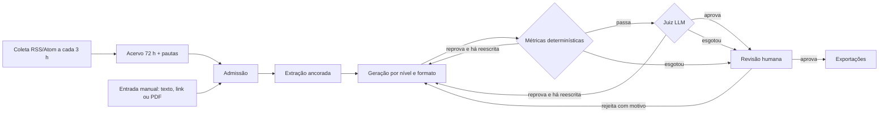

# Perspecta: notícias financeiras adaptadas em três níveis

# Perspecta 

Documentos e notícias do mercado financeiro, como atas do Copom, comunicados do Banco Central e relatórios de empresas, frequentemente exigem conhecimento técnico para serem compreendidos. Adaptar esse conteúdo manualmente para diferentes públicos e formatos é um processo demorado. Já o uso direto de modelos de linguagem (LLMs) traz riscos importantes, como informações sem respaldo nas fontes, distorções de dados, recomendações de investimento indevidas e simplificações que comprometem o rigor da análise.

O Perspecta é um pipeline de IA desenvolvido para transformar informações financeiras em conteúdos adaptados aos níveis Iniciante, Intermediário e Avançado, em três formatos: texto analítico, carrossel para Instagram e roteiro de vídeo. O sistema agrupa notícias sobre um mesmo acontecimento publicadas por diferentes fontes, extrai fatos vinculados aos documentos originais e estrutura as informações para gerar materiais adequados a cada público.

Seu principal diferencial é um avaliador híbrido de qualidade, que combina métricas determinísticas, julgamento estruturado por outro modelo de linguagem e ciclos controlados de reescrita. O objetivo é verificar tanto a fidelidade factual quanto a adequação do vocabulário e da profundidade analítica, evitando que a adaptação se limite a encurtar textos ou substituir palavras difíceis por termos mais simples.

Antes de qualquer exportação, cada material passa por revisão humana, que permite aprovar, editar ou rejeitar o conteúdo com justificativa. Dessa forma, o Perspecta combina automação, rastreabilidade e controle editorial para apoiar a produção de conteúdo financeiro com diferentes níveis de profundidade.

## Visão geral



- **Coleta** ([src/collection](src/collection)): 7 feeds ativos de 6 fontes (InfoMoney, Money Times, Seu Dinheiro,
  E-Investidor, Agência Brasil e dois do Banco Central). Só entram notícias de tema financeiro com texto completo que
  passa na admissão. A mesma notícia de fontes diferentes vira uma **pauta comparável**.
- **Pipeline** ([src/pipeline](src/pipeline)): grafo LangGraph com estado Pydantic. O estado recusa campo
  desconhecido, para que nada se perca em silêncio entre os nós.
- **Formatos**: texto analítico (350–500 palavras; 600–900 quando compara fontes), carrossel de 5 slides
  1080×1350 com legenda, roteiro de até 60 s em 5 cenas.
- **Interface** ([src/app](src/app)): Streamlit. Notícias e pautas, geração, hub de materiais com
  pré-visualização, revisão humana e exportações, glossário.
- **Persistência**: PostgreSQL relacional (execuções, materiais, tentativas, avaliações do juiz, decisões
  humanas) e grafo em tabelas (`nos_grafo`/`arestas_grafo`). Cada frase gerada fica ligada à afirmação da fonte
  que a sustenta.

## Interface

Demonstração em vídeo (5 min, navegação por todas as telas): [asset/interface/perspecta_demo.mp4](asset/interface/perspecta_demo.mp4)

## Metodologia de avaliação

A avaliação tem cinco camadas. Cada uma só roda se a anterior deixar.

### 1. Admissão do documento 

Recusa conteúdo parcial (paywall, texto cortado), fora do português, ou com menos de 200 palavras e 5 termos
distintos do glossário. A coleta usa a mesma admissão, então um card só aparece se for gerável.

### 2. Avaliador determinístico 

Mede cada tentativa sem LLM. Os limiares ficam em [config/limiares.yaml](config/limiares.yaml); nenhum fica
escrito no código.

| Grupo | O que é medido |
|---|---|
| Nível | Flesch adaptado ao português (fórmula de Martins: 248,835 − 1,015·palavras/frase − 84,6·sílabas/palavra) e densidade de termos técnicos do glossário por 100 palavras |
| Fidelidade | Número ou data que não está na fonte; variação ("subiu", "caiu") que a fonte não declara; frases sem respaldo na fonte ou nas afirmações extraídas; cobertura dos 3 pontos centrais |
| Segurança editorial | Linguagem de recomendação (compra, venda), termos proibidos, emoji, marcador "Em geral," fora do glossário aprovado |
| Qualidade do texto | Frases e trigramas repetidos (contra enchimento), parágrafo longo, título e subtítulo, proporção das seções |
| Formato | Carrossel: 5 slides, um ponto por slide de corpo, slides repetidos, linha do nível, legenda e chamada para ação. Roteiro: 5 cenas, tempos, ritmo de fala (2 a 3 palavras/s), texto na tela |
| Comparação de fontes | Divergência mostrando os dois lados, nenhum veredito sobre qual fonte está certa, número sempre atribuído à fonte, linha da matriz existente |

Faixas de nível em uso (provisórias, a calibrar):

| Nível | Flesch PT-BR | Termos técnicos por 100 palavras |
|---|---|---|
| Iniciante | ≥ 55 | ≤ 3 |
| Intermediário | 40 a 55 | 3 a 8 |
| Avançado | ≤ 40 | ≥ 8 |

O **classificador de nível** ([src/evaluation/level_classifier.py](src/evaluation/level_classifier.py)) devolve um
nível só quando legibilidade e densidade caem na faixa do mesmo nível. Caso contrário devolve **indistinto**:
um texto com a legibilidade de um nível e a densidade de outro não é contado como acerto de nenhum.

Cada falha vira um item de feedback numérico para a reescrita (`métrica = valor, limiar = faixa`), e não uma
frase vaga.

### 3. Juiz LLM 

- Usa outro modelo, `openai/gpt-oss-120b` (o gerador é o `openai/gpt-oss-20b`), e só roda depois que a tentativa
  passa nas métricas determinísticas.
- A rubrica é versionada ([rubric.yaml](src/evaluation/rubric.yaml), versão 2.0) e tem âncoras de nota por
  critério:

  | Critério | Peso |
  |---|---|
  | fidelidade_semantica | 1,5 |
  | nuance_e_grau_de_certeza | 1,2 |
  | adequacao_ao_nivel | 1,0 |
  | profundidade_sem_trivializar | 1,0 |
  | tom_e_guia_de_estilo | 0,8 |
  | analogias_e_explicacoes | 0,8 |

- A comparação de fontes usa [rubric_triangulado.yaml](src/evaluation/rubric_triangulado.yaml), com três
  critérios a mais: fidelidade_atribuicao (1,3), neutralidade (1,2) e representacao_justa (1,0).
- O juiz devolve nota, justificativa e evidências por critério. **A aprovação é calculada pelo código**, não
  declarada pelo modelo: média ponderada ≥ 7,0 e nenhum critério abaixo de 5,0.

### 4. Ciclo de reescrita 

- No máximo 2 reescritas, ou seja, até 3 tentativas por nível e formato (`reescritas_maximas`).
- Para antes do teto se a reescrita sair 97% igual à anterior: reescrever de novo não mudaria o resultado.
- Ao esgotar, o material vai para revisão humana com um aviso do motivo, e nunca como aprovado.
- Cada tentativa fica gravada com conteúdo, métricas, falhas, feedback usado, tokens, latência e versão do
  prompt.

### 5. Revisão humana 

- **Aprovar** libera as exportações (Markdown, HTML com gráficos, PNGs do carrossel, roteiro e prompt de vídeo).
- **Editar** exige texto alterado e uma observação do que mudou. O texto editado é reavaliado pelas mesmas
  métricas do nível.
- **Rejeitar** exige motivo, com categorias opcionais. O material rejeitado é estado final: pode ser reaberto
  ou gerado de novo, e a nova versão leva o motivo como orientação em todas as tentativas.
- Toda decisão e sua observação ficam em `decisoes_humanas`.

### Benchmark adversarial do avaliador
[tests/audit/audit_b6_cases.py](tests/audit/audit_b6_cases.py) traz 3 saídas boas escritas à mão (uma por
nível) e 15 saídas ruins, cada uma com um defeito conhecido:
- número ou data inventados;
- recomendação de compra;
- emoji (inclusive fora da faixa da regex);
- termo proibido;
- jargão sem explicação no Iniciante;
- texto Iniciante entregue como Avançado;
- ponto central ausente;
- enchimento com frases repetidas, inclusive enchimento montado para burlar os limites;
- slides repetidos.

[tests/unit/test_avaliador_deterministico.py](tests/unit/test_avaliador_deterministico.py) exige que as 3 boas
passem no nível certo e que cada ruim reprove **pelo motivo esperado**, e não por acaso.

### Avaliação da coleta (pautas)
O agrupamento de notícias usa cosseno TF-IDF de título, descrição e começo do texto. Também exige uma entidade
específica em comum (nome, sigla ou código de ação). Na calibração de 18/10/2026, com 47 notícias financeiras de
7 feeds:
- os pares verdadeiros deram 0,77 e 0,66;
- o maior par falso deu 0,37.

O limiar ficou em 0,40 e está marcado como provisório em [config/coleta_fontes.yaml](config/coleta_fontes.yaml).

---

## Matriz de confusão de níveis

Linhas: nível pedido. Colunas: nível classificado pelo classificador do pipeline. Os números vêm de
[documents/resultados_experimentais.md](documents/resultados_experimentais.md).

### Benchmark escrito à mão (3 saídas boas + 2 com o nível trocado)

| Pedido \ Classificado | Iniciante | Intermediário | Avançado | Indistinto | Recall |
|---|---|---|---|---|---|
| **Iniciante** | 1 | 0 | 0 | 1 | 0,50 |
| **Intermediário** | 0 | 1 | 0 | 0 | 1,00 |
| **Avançado** | 0 | 0 | 1 | 1 | 0,50 |

n = 5; acerto = 60%; precisão = 1,00 nos três níveis.

- As três saídas boas são classificadas no nível certo.
- As duas com o nível trocado caem em **indistinto**, não em outro nível. São elas: um Iniciante com jargão sem
  explicação (Flesch 65,8, densidade 5,16) e um texto Iniciante entregue como Avançado (Flesch 73,9, densidade
  3,21).
- Isso é intencional: indistinto reprova no limite do nível pedido, e o classificador nunca confirma um nível
  errado.

### Saídas reais do modelo (27 tentativas, 1 documento)

Esta é a execução ao vivo de 17/10/2026, 14:47 (Brasília): notícia "Prospera MEI" (Money Times), 3 níveis ×
3 formatos × até 3 tentativas, gerador `openai/gpt-oss-20b`.

| Pedido \ Classificado | Iniciante | Intermediário | Avançado | Indistinto | Recall |
|---|---|---|---|---|---|
| **Iniciante** | 3 | 0 | 0 | 6 | 0,33 |
| **Intermediário** | 1 | 0 | 0 | 8 | 0,00 |
| **Avançado** | 3 | 0 | 0 | 6 | 0,00 |

n = 27; acerto = 11%; indistinto = 20 de 27; precisão do Iniciante = 0,43; Intermediário e Avançado nunca foram
previstos (precisão indefinida). Reclassificar o conteúdo gravado com o código atual dá a mesma matriz.

**Leitura dos resultados:**
- **O gerador não diferenciou os níveis nesse documento.** Nenhuma tentativa pedida como Intermediário ou
  Avançado foi classificada nesses níveis.
- **As falhas confirmam isso.** As mais frequentes nas 27 tentativas foram densidade fora da faixa (17) e
  legibilidade fora da faixa (15). Depois vieram número ou data sem origem (13), trigramas repetidos (7) e
  variação não declarada pela fonte (7).
- **Os 9 materiais terminaram "reprovado nas métricas"** depois de 3 tentativas cada. Por isso o juiz não rodou
  nenhuma vez.
- **O comportamento esperado se manteve:** nada reprovado foi apresentado como aprovado, e cada material chegou
  à revisão com o motivo.

**Limitações desta medição:**
- É 1 documento só, então serve como diagnóstico e não como estimativa de desempenho.
- As faixas de Flesch e densidade são provisórias.
- A amostra precisa crescer com mais documentos em modo `live` antes de calibrar as faixas e o prompt de cada
  nível.

---

## Custo e latência: medições e trade-offs

### Medido na execução real (gerador `openai/gpt-oss-20b`)

| Etapa | Chamadas | Tokens | Tokens por chamada | Latência média por chamada |
|---|---|---|---|---|
| Texto analítico | 9 | 32.009 | 3.557 | 1,39 s |
| Carrossel | 9 | 30.350 | 3.372 | 1,47 s |
| Roteiro de vídeo | 9 | 34.109 | 3.790 | 1,99 s |
| Geração (total) | 27 | 96.468 | 3.573 | 1,62 s |
| Extração (estimada: total da execução − geração) | — | 10.903 | — | — |
| **Execução completa (3 níveis × 3 formatos)** | | **107.371** | | **49,6 s somados** |

- A latência somada é o tempo das chamadas ao modelo. Ela não inclui esperas por limite de taxa do provedor nem
  a renderização dos slides, que não foram medidas.
- O custo do juiz **não foi medido**, porque ele não rodou nessa execução.
- O custo em dinheiro não está no repositório. A unidade aqui é o token; para obter o valor, multiplique pelo
  preço vigente do provedor para cada modelo.

### Trade-offs
- **Teto de reescritas.** Cada tentativa de geração custou em média ~3,6 mil tokens e ~1,6 s.
  - Com o teto atual (2 reescritas), um documento nos 3 níveis vai de 9 chamadas de geração (tudo passa de
    primeira) a 27 (tudo reprova, como na execução medida).
  - Subir o teto aumenta o custo de forma linear. A execução medida mostra que, quando o problema é o nível
    (legibilidade e densidade), mais reescritas raramente resolvem: o ciclo para antes quando a reescrita repete
    a anterior.
- **Juiz só depois das métricas.** O juiz é o modelo maior. Chamá-lo só quando a tentativa já passou nas métricas
  evita pagar por avaliar textos que já seriam reprovados; na execução medida, isso evitou as 27 chamadas.
- **Modelo menor para gerar, maior para julgar.** O `gpt-oss-20b` com `reasoning_effort=low` mantém a geração
  barata e rápida. O juiz independente (`gpt-oss-120b`, temperatura 0) reduz o viés de autoavaliação. Trocar o
  gerador pelo modelo maior deve melhorar a aderência ao nível, mas multiplica o custo das 9 a 27 chamadas.
  Esse efeito não foi medido.
- **Extração uma vez por documento.** Os ~10,9 mil tokens da extração são divididos entre as 9 combinações de
  nível e formato. Gerar um nível só ainda paga a extração inteira.
- **Cache por prompt** (`CACHE_DIR`, modos `live` e `record`). Rodar de novo com o mesmo documento, prompt, modelo
  e versões custa zero tokens. "Gerar nova versão" de um material rejeitado reaproveita a extração do cache
  quando disponível.
- **Comparação de fontes.** Cada fonte é extraída separadamente, e há uma chamada de alinhamento entre elas. O
  custo cresce com o número de fontes (2 a 5), em troca de um texto que mostra divergências lado a lado.
  Gráficos, matriz e cálculo de diferenças são feitos por código, sem tokens.
- **Coleta e pautas sem LLM.** Seleção, admissão, agrupamento e gráficos são determinísticos e não custam tokens.
- **Limites do provedor.** O cliente respeita limites de chamadas, de tokens por minuto e de tokens de saída por
  minuto (`GROQ_MAX_CALLS_PER_RUN`, `GROQ_TPM`, `GROQ_OTPM`). Quando recebe a resposta 429, espera o tempo
  indicado pelo provedor. Isso troca latência por não estourar a cota.

---

## Reprodutibilidade

### Pré-requisitos
- Docker e Docker Compose (caminho recomendado); **ou** Python 3.11+ e PostgreSQL 16.
- Chave da Groq **apenas** para gerar com o modelo real (`LLM_MODE=live`). Testes, benchmark, coleta e interface
  rodam sem chave.

### Subir com Docker
```bash
cp .env.example .env          # preencha GROQ_API_KEY e os modelos se for usar o modo live
docker compose up --build -d  # postgres, app (Streamlit) e collector (coleta a cada 3 h)
docker compose exec app python scripts/migrate.py        # cria/atualiza o schema (idempotente)
docker compose exec app python scripts/seed_glossary.py  # glossário a partir do BCB (opcional: já versionado)
```
A interface fica em `http://localhost:8501`. Para coletar notícias na hora:
`docker compose exec app python -m src.collection.scheduler run`.

### Rodar localmente, sem Docker
```bash
python -m venv .venv && . .venv/bin/activate       # Windows: .venv\Scripts\activate
pip install -r requirements.txt
python -m playwright install chromium               # renderização dos slides do carrossel
cp .env.example .env                                # ajuste DATABASE_URL para o seu PostgreSQL
python scripts/migrate.py
streamlit run src/app/main.py
```

### Configuração (`.env`)
| Variável | Para quê |
|---|---|
| `LLM_MODE` | `simulated` (padrão: só respostas gravadas, sem rede), `live` (chama a Groq) ou `record` (chama e grava as respostas para replay) |
| `GROQ_API_KEY`, `GROQ_GENERATION_MODEL_ID`, `GROQ_JUDGE_MODEL_ID` | Chave e modelos. Usados: `openai/gpt-oss-20b` (geração) e `openai/gpt-oss-120b` (juiz). Gerador e juiz precisam ser modelos diferentes |
| `GROQ_GENERATION_REASONING_EFFORT`, `GROQ_*_TEMPERATURE` | Esforço de raciocínio e temperatura (juiz em 0) |
| `GROQ_MAX_CALLS_PER_RUN`, `GROQ_TPM`, `GROQ_OTPM`, `GROQ_MAX_RETRIES_429` | Limites de custo e de taxa por execução |
| `CACHE_DIR`, `DOCUMENTS_DIR` | Cache das respostas do modelo e textos originais dos documentos (pelo hash) |
| `DATABASE_URL` | PostgreSQL |

No modo `simulated`, a interface só gera se houver respostas gravadas em `tests/fixtures/llm_responses`. Para
gravá-las, rode uma vez em modo `record`.

### Testes
```bash
python -m pytest                       # unit, offline, regressão, integração e e2e (≈350 testes)
python -m pytest tests/unit tests/offline   # sem banco
```
- Os testes usam um cliente de modelo falso ([tests/fakes/llm.py](tests/fakes/llm.py)): nenhum teste chama a rede.
- Os testes de integração precisam do PostgreSQL e são pulados, com o motivo, quando ele não responde. Eles
  gravam e apagam só as próprias linhas no banco configurado.

### Reproduzir os números deste README
```bash
python scripts/relatorio_experimental.py --sem-banco   # benchmark: não precisa de banco nem de chave
python scripts/relatorio_experimental.py               # + matriz e custos das execuções gravadas no PostgreSQL
```
O script reescreve [documents/resultados_experimentais.md](documents/resultados_experimentais.md) e o `.json` ao
lado. Para medir um documento novo: gere materiais pela interface (ou com
`LLM_MODE=live python scripts/_check_report.py documento.txt iniciante`) e rode o script de novo.

### O que fica registrado para auditar uma execução
- **Execução** (`execucoes`): hash do documento e da configuração, e versões do glossário, dos prompts, dos
  limiares, da rubrica, do guia de estilo e dos modelos.
- **Tentativa** (`tentativas`): conteúdo, métricas, falhas, feedback usado, tokens, latência, modelo e versão do
  prompt.
- **Juiz** (`avaliacoes_juiz`): notas, justificativas e evidências por critério.
- **Grafo:** cada frase gerada se liga à afirmação e ao trecho da fonte que a sustentam.

---

## Estrutura do repositório

| Caminho | Conteúdo |
|---|---|
| [src/collection](src/collection) | Feeds RSS/Atom, leitura de página, seleção financeira, acervo e pautas, agendador |
| [src/admission](src/admission) | Admissão de texto, link e PDF |
| [src/extraction](src/extraction) | Extração ancorada (pontos centrais, afirmações, números, entidades) e gravação no grafo |
| [src/generation](src/generation) | Geradores por formato, prompts por nível, partes montadas por regra (fonte, caixa "Entenda os termos", legenda) |
| [src/triangulacao](src/triangulacao) | Dossiê de fontes, alinhamento, matriz e gráficos da comparação |
| [src/evaluation](src/evaluation) | Métricas determinísticas, classificador de nível, juiz e rubricas |
| [src/pipeline](src/pipeline) | Grafo LangGraph, nós, ciclo de reescrita, persistência |
| [src/rendering](src/rendering) | Slides do carrossel (HTML + Playwright) |
| [src/export](src/export) | Exportação de texto (Markdown/HTML) e roteiro |
| [src/app](src/app) | Interface Streamlit |
| [config](config) | Limiares, glossário, fontes da coleta, termos proibidos, guia de estilo, identidade visual |
| [scripts](scripts) | Migração, glossário, verificação de fontes, relatório experimental |
| [tests](tests) | Unitários, offline, regressão, integração, e2e e auditoria |
| [documents](documents) | Arquitetura, plano de implementação e relatórios experimentais |

---

## Regra de fidelidade (inclui a emenda de comparação de fontes)

- Nenhum número ou data fora das fontes, nenhuma recomendação de compra ou venda, nenhum emoji e nenhuma opinião
  do sistema.
- Projeções são relatadas como projeções. O marcador "Em geral," só aparece com frases do glossário aprovado.
- **Comparar fontes do mesmo assunto e período é permitido**, sempre com atribuição ("a fonte A informa X; a
  fonte B informa Y").
- O sistema nunca decide qual fonte está certa. Divergências numéricas são calculadas por função, nunca pelo
  modelo.
- A mesma matéria de agência publicada em dois sites conta como uma fonte só.
- O sistema nunca calcula "o que mudou" entre documentos de datas diferentes.

---

## Limitações conhecidas e próximos passos

1. **Nível:** na única execução real medida, o gerador não diferenciou Intermediário e Avançado. Próximo passo:
   rodar mais documentos em modo `live`, recalibrar as faixas de Flesch e densidade e reforçar os prompts de
   nível.
2. **Juiz sem medição real:** ainda não há notas reais do juiz gravadas, então a distribuição das notas e a
   concordância entre juiz e revisão humana não foram medidas
   ([src/evaluation/concordance.py](src/evaluation/concordance.py) está pronto para isso).
3. **Limiares provisórios** estão marcados como tal em `config/limiares.yaml` e `config/coleta_fontes.yaml`.
4. **Fontes:** os feeds do Banco Central responderam HTTP 400 em 18/10/2026, por causa não verificada. Exame e
   Investing seguem inativos: a Exame monta o texto no navegador e a Investing responde 403. Os termos de uso
   de cada site precisam ser confirmados antes de uso em produção.
5. **Glossário:** as 204 entradas vêm do glossário de cidadania financeira do BCB e estão pendentes de
   aprovação. Só entradas aprovadas entram nas explicações.
